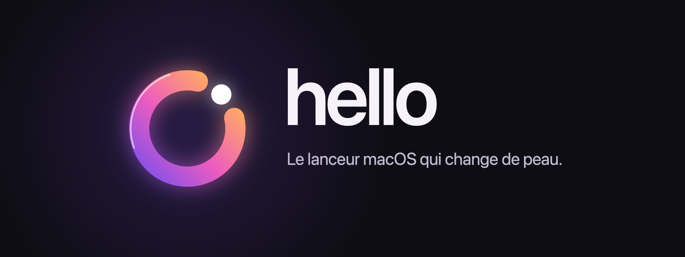
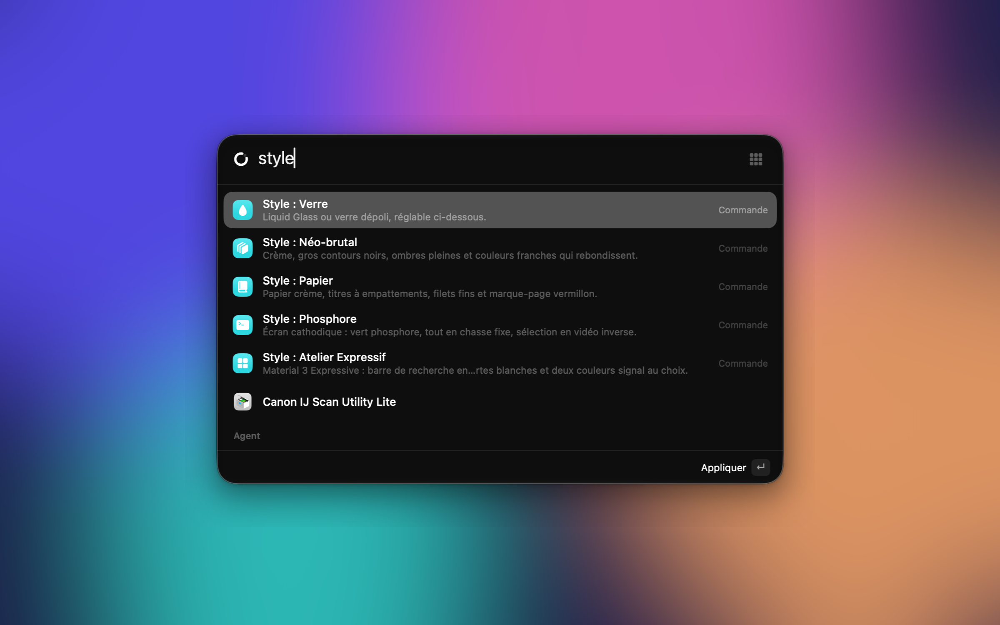
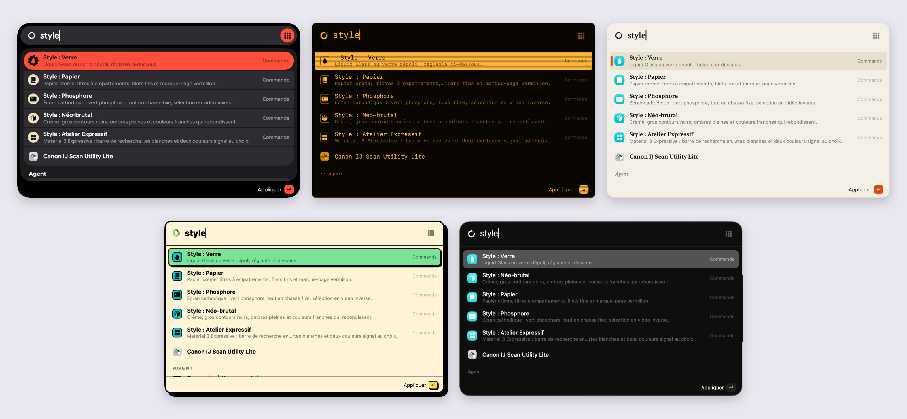
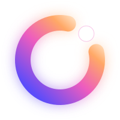

<p align="center">
  
</p>

<p align="center">
  <b>Un lanceur natif pour macOS, façon Raycast ou Alfred : apps, terminal, presse-papiers, emoji, couleurs… derrière ⌘ Espace.</b><br>
  Swift · SwiftUI · Liquid Glass · aucune dépendance · macOS 14+
</p>

> [!WARNING]
> **Version alpha** — Hello est encore en développement. Certaines fonctions peuvent changer ou comporter des bugs.

<p align="center">
  <a href="#installation">Installation</a> ·
  <a href="#ce-que-fait-hello">Fonctionnalités</a> ·
  <a href="#cinq-peaux">Cinq peaux</a> ·
  <a href="#sous-le-capot">Sous le capot</a>
</p>

<p align="center">
  
</p>

## Ce que fait Hello

Tu appuies sur **⌘ Espace**, tu tapes deux lettres, c'est ouvert. Hello apprend ce que tu utilises (« saf » → Safari apprend aussi « s » et « sa »), donc une ou deux lettres suffisent vite.

| Tape | Effet |
|---|---|
| `saf` | Ouvre Safari : recherche floue, classement par **frécence** (fréquence × récence) et préfixes appris |
| `apps`, ▦ ou balayage vers la droite | Toutes les applications en grandes icônes, par pages, au trackpad ou au clavier |
| `cd ~/code`, `z proj` | Ouvre le dossier dans le Finder (⌘↵ : terminal, ⌥↵ : éditeur) ; ⇥ complète le chemin, branche git affichée |
| `> git status` | Exécute dans zsh, sortie en couleur dans Hello (⌘↵ : dans le terminal, ⌃C stop, ⌘R relancer) |
| `kill slack`, `port 3000`, `ip` | Terminer un processus, voir qui écoute sur un port, adresses IP |
| `presse` | Historique du presse-papiers : texte, images, fichiers (↵ colle, ⌘↵ copie) |
| `emoji` | Emoji et symboles Unicode, recherche en français ou en anglais |
| `couleur` | Pipette : HEX copié, puis HEX / RGB / HSL / SwiftUI |
| `désinstaller` ou ⌘⌫ sur une app | Désinstallation propre : l'app et ses fichiers, en choisissant ce qu'on garde |
| `? ta question` | Agent IA (Hermes) : réponse rapide, recherche web ou session dans le terminal |
| `gh apple/swift` | Commandes perso avec argument `{}` |
| `menu`, `stats`, `style`, `focus` | Barre des menus, statistiques, changement de style, mode focus |

`↑↓` naviguer · `↵` action · `⌘↵` / `⌥↵` actions secondaires · `⇧↵` copier · `esc` retour

## Cinq peaux

Le même lanceur, cinq directions artistiques complètes. Chacune a ses couleurs, sa typographie, sa sélection, ses icônes et **ses propres animations**.

<p align="center">
  
</p>

| Style | Matière | À l'ouverture |
|---|---|---|
| **Verre** | Liquid Glass (ou verre dépoli), teintes réglables | un reflet multicolore fait le tour du bord |
| **Atelier Expressif** | Material 3 Expressive : barre de recherche en pilule, listes segmentées, formes qui se transforment, Google Sans Flex, six thèmes de couleurs | le panneau se déploie depuis la recherche, un anneau de focus s'y dessine |
| **Phosphore** | écran cathodique en chasse fixe, vert, ambre, blanc ou cyan | allumage du tube, balayage, résultats affichés ligne par ligne |
| **Papier** | papier crème, ivoire ou nuit, titres à empattements | la page se déplie, un trait d'encre se trace sous la recherche |
| **Néo-brutal** | contours noirs, ombres pleines, couleurs franches | le panneau tombe et rebondit sur son ombre |

Tout se règle dans **Réglages › Apparence** et **Réglages › Animations** : intensité et vitesse des animations, densité des lignes, taille du texte, et un **mode focus** qui n'affiche que la barre de recherche à l'ouverture.

## Le logo



Un anneau ouvert et son point. C'est le « o » de *hello*, et la tête du reflet qui fait le tour du panneau quand il apparaît. À chaque ouverture, le point s'allume et l'anneau en part pour faire le tour. Dans la barre de recherche, il est en noir et blanc avec le Verre et prend la matière des autres styles.
<br clear="left">

## Installation

```sh
git clone https://github.com/matthieuleconte1/Hello.git && cd Hello
./build.sh install     # compile, copie dans /Applications et lance
```

Il suffit des outils en ligne de commande d'Apple (`xcode-select --install`) : pas besoin d'Xcode.

Pour partager l'app : `./build.sh dist` produit `build/Hello-<version>.dmg` (Apple Silicon + Intel, demande Xcode), avec un `LISEZ-MOI.txt` qui explique comment passer l'avertissement de Gatekeeper (app non notarisée). Penser à incrémenter `CFBundleShortVersionString` dans `Resources/Info.plist` avant chaque envoi.

Le raccourci par défaut est **⌘ Espace** : il faut alors libérer celui de Spotlight (proposé à l'accueil et dans Réglages › Permissions). On peut en choisir un autre (⌥ Espace, ⌃ Espace…).

> Hello s'appelait **Halo**. Au premier lancement, il reprend tout seul les réglages, les statistiques et l'historique de l'ancienne app.

## Permissions

- **Accessibilité** (facultatif) : pour *coller* directement un emoji ou un élément du presse-papiers dans l'app active. Sans elle, Hello copie simplement. La signature ad hoc change à chaque recompilation : il faut alors recocher Hello dans Réglages Système › Confidentialité › Accessibilité.
- **Contrôle du Finder** (facultatif) : pour mettre à la corbeille les fichiers protégés lors d'une désinstallation (le Finder demande le mot de passe).
- Ni micro, ni caméra, ni enregistrement de l'écran : la pipette utilise la loupe du système.

## Énergie et vie privée

- Pas d'icône dans le Dock, pas de processus annexe ; raccourci global via Carbon (zéro coût au repos).
- Index des apps : simple lecture de dossiers, refaite au plus une fois par minute à l'ouverture.
- Presse-papiers : lecture d'un compteur toutes les ~0,75 s, avec tolérance pour que macOS regroupe les réveils. Les copies marquées « confidentielles » (1Password, Bitwarden…) sont ignorées.
- Tout reste sur le Mac, dans `~/Library/Application Support/Hello/` (historique en 0600).

## Sous le capot

Environ 10 000 lignes de Swift, sans dépendance, dans un Swift Package (pas de projet Xcode).

| Fichier | Rôle |
|---|---|
| `Controller.swift` | la fenêtre flottante, le raccourci, l'ouverture et la fermeture |
| `LauncherModel.swift` | les modes, la recherche, le clavier, les actions |
| `Views.swift` | le panneau en SwiftUI : liste, grille d'apps, aperçus, terminal |
| `Styles.swift`, `Motion.swift`, `Mark.swift` | les cinq peaux, leurs animations, le logo |
| `Windows.swift` | réglages façon Réglages Système et accueil |
| `AppIndex.swift`, `Usage.swift` | index des apps, frécence et apprentissage |
| `Shell.swift`, `Terminal.swift` | commandes shell, pseudo-terminal, dossiers, ports, processus |
| `Clipboard.swift`, `Glyphs.swift`, `Colors.swift` | presse-papiers, emoji, pipette et barre des menus |
| `Uninstaller.swift`, `Agent.swift` | désinstallation propre, agent IA |

L'icône et la bannière sont dessinées par du code : `swift Scripts/make-icon.swift` et `swift Scripts/make-banner.swift`.
